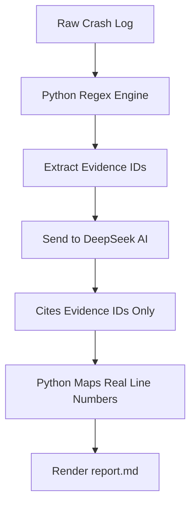

<div align="center">
  <h1>🔍 Veyra</h1>
  <p><b>Stop AI hallucinations in game crash logs. Extract real evidence, map exact line numbers.</b></p>
  <p><i>告别大模型瞎编报错，用 Python 约束 AI 真实提取游戏崩溃证据。</i></p>

  
  
  
  
</div>

**English** | [简体中文](./README_zh.md)

Veyra is a general-purpose, local command-line tool for game mod crash logs. It extracts exception evidence from a log file with Python, assigns evidence IDs, and renders a structured Markdown triage report. The evidence-extraction and line-mapping pipeline is engine-agnostic; the current regex library is deeply optimized for the Java/Minecraft ecosystem first. An optional DeepSeek API mode can fill in the narrative fields, but the model may only reference the evidence IDs that Python extracted — Python owns the line numbers that appear in the report. A machine-readable JSON mode (`--format json`, `schema_version` 1.0.0) exposes the same structured analysis for downstream tooling; see [docs/json-contract.md](docs/json-contract.md).

The repository also contains an Agent Skill that turns the JSON output into an evidence-cited analysis and a maintainer reply draft. See [skills/mod-issue-triage/SKILL.md](skills/mod-issue-triage/SKILL.md) and the [Skill workflow](#skill-workflow).

<a id="toc"></a>
## 📖 Table of Contents / 目录

| English | 中文 |
| --- | --- |
| [Why Veyra?](#why-veyra) | [为什么用 Veyra？](#why-veyra) |
| [Important Notices](#notices) | [重要声明](#notices) |
| [Quick Start](#quick-start) | [快速开始](#quick-start) |
| [Features](#features) | [功能特性](#features) |
| [How it works](#how-it-works) | [工作原理](#how-it-works) |
| [Skill workflow](#skill-workflow) | [Skill 工作流](#skill-workflow) |
| [Installing the Skill files](#install-skill) | [安装 Skill 文件](#install-skill) |
| [Limitations](#limitations) | [已知限制](#limitations) |
| [Roadmap](#roadmap) | [路线图](#roadmap) |
| [Contributing](#contributing) | [参与贡献](#contributing) |
| [Support](#support) | [支持](#support) |
| [License](#license) | [许可证](#license) |

<a id="why-veyra"></a>
## 💡 Why Veyra? / 为什么用 Veyra？

> ❌ **Just paste the log into ChatGPT**: "Your game crashed at line 142; it is probably a mod conflict." *(The AI made that up — your log may not even have 142 lines.)*
>
> ✅ **Use Veyra**: Python extracts the log first, assigns `[E1]` evidence IDs, and the model may only cite `[E1]`. The final report's line numbers are reconstructed by Python from the evidence table — no guessing, no invented line numbers.

<a id="notices"></a>
## ⚠️ Important Notices / 重要声明

> [!NOTE]
> **Core Difference** — The CLI uses Python-generated evidence IDs and line mappings to constrain log references, reducing the risk of fabricated line numbers in model-assisted reports. It does not guarantee that the model's diagnosis is correct.

> [!WARNING]
> **Default output replaces `report.md`.** If you do not pass `--output`, the CLI writes `report.md` into the **current working directory** and replaces an existing file without a backup. The write itself is atomic (temporary file + `os.replace`), missing parent directories are created automatically, and the CLI **refuses to write** when the output path is the same file as the input log. Use `-o <path>` / `--output <path>` to keep an earlier report.

> [!IMPORTANT]
> **Skill and CLI are connected by a manual handoff, not by code.** Run the CLI, save the JSON, then give that JSON (pasted text or an attached file, depending on what your chat client supports) and the player's issue text to the Skill. The Skill never invokes the CLI, the CLI does not load the Skill, and nothing is posted to GitHub automatically.

> [!NOTE]
> **The Skill consumes the JSON contract (`schema_version` 1.0.0).** `--format json` emits the contract described in [docs/json-contract.md](docs/json-contract.md) (JSON Schema: [docs/report.schema.json](docs/report.schema.json)). The Skill validates it first, cites only evidence IDs that already exist in it, and produces a reply draft for the maintainer to edit and send manually.

> [!CAUTION]
> **API mode stability.** The DeepSeek API mode has only been tested a very small number of times. Connection stability and response formatting are **not guaranteed**. Local mode requires no API key and no network access.

<a id="quick-start"></a>
## ⚡ Quick Start

```bash
# Local mode (no API key required)
TRIAGE_LOCAL_MODE=1 python triage_agent.py demo/sample-crash.log
```


> 💡 **Not set up yet? Want to see the output first?** Check the [Demo preview report](demo/expected-report-preview.md) — it is exactly what a local run produces.

### Requirements

- Python 3.10 or later is recommended (development and testing environment is 3.10+). Standard library only; no third-party packages.
- No API key for local mode.

### Local mode (no API key, no network)

Run the commands below **from the root of your cloned Veyra repository**. The `demo/sample-crash.log` argument is a path relative to that root; the same applies to the API-mode example further down.

```powershell
# PowerShell
$env:TRIAGE_LOCAL_MODE = "1"
python triage_agent.py demo/sample-crash.log
```

```bash
# Bash
TRIAGE_LOCAL_MODE=1 python triage_agent.py demo/sample-crash.log
```

`report.md` is written to the current directory. Use `-o <path>` / `--output <path>` to choose a different file and avoid overwriting an existing report. `demo/sample-crash.log` is synthetic data for testing and demonstration only; it is not a real crash report.

### JSON output (machine-readable)

Use `--format json` to emit the same analysis as a structured object. Without `-o`, the JSON goes to **stdout** and nothing is written to disk; progress and errors go to **stderr**, so the stdout stream stays parseable.

```powershell
# Print JSON to stdout
$env:TRIAGE_LOCAL_MODE = "1"
python triage_agent.py demo/sample-crash.log --format json

# Write JSON to a file (atomic replace, same safety rules as report.md)
python triage_agent.py demo/sample-crash.log --format json -o result.json
```

```bash
TRIAGE_LOCAL_MODE=1 python triage_agent.py demo/sample-crash.log --format json | python -m json.tool
```

`-o` is reused for both formats: it always means "write to this file at this path". Passing `--format json` without `-o` is the only form that prints to stdout. See [docs/json-contract.md](docs/json-contract.md) for the field-by-field contract.

If you omit the path, the CLI reads `crash_log.txt` from the current directory:

```powershell
python triage_agent.py
```

### API mode (optional)

Any OpenAI-compatible endpoint works. The `LLM_*` variables take precedence over `DEEPSEEK_*`.

```powershell
# DeepSeek (default endpoint)
$env:DEEPSEEK_API_KEY = "<your API key>"
python triage_agent.py demo/sample-crash.log

# Kimi / Moonshot (OpenAI-compatible)
$env:LLM_API_KEY = "<your key>"
$env:LLM_BASE_URL = "https://api.moonshot.cn/v1"
$env:LLM_MODEL = "moonshot-v1-8k"
python triage_agent.py demo/sample-crash.log -o report-kimi.md

# Local Ollama (OpenAI-compatible; any non-empty key is accepted by the CLI)
$env:LLM_API_KEY = "ollama"
$env:LLM_BASE_URL = "http://localhost:11434/v1"
$env:LLM_MODEL = "llama3.1"
python triage_agent.py demo/sample-crash.log -o report-ollama.md
```

Environment variables:

| Variable | Required | Meaning |
| --- | --- | --- |
| `LLM_API_KEY` | API mode (preferred) | API key for any OpenAI-compatible service. Overrides `DEEPSEEK_API_KEY`. |
| `LLM_BASE_URL` | No | Base URL of the compatible service. Overrides `DEEPSEEK_BASE_URL`. |
| `LLM_MODEL` | No | Model name. Overrides `DEEPSEEK_MODEL`. |
| `DEEPSEEK_API_KEY` | API mode (fallback) | DeepSeek key, used only when `LLM_API_KEY` is unset. |
| `DEEPSEEK_BASE_URL` | No | DeepSeek base URL (default `https://api.deepseek.com`), used only when `LLM_BASE_URL` is unset. |
| `DEEPSEEK_MODEL` | No | DeepSeek model name (default `deepseek-chat`), used only when `LLM_MODEL` is unset. |
| `TRIAGE_LOCAL_MODE` | No | Set to `1` / `true` / `yes` / `on` to force local mode. |
| `TRIAGE_DESCRIPTION` | No | Optional user description passed to the report prompt. |

If the `LLM_*` variables are set, they override the corresponding `DEEPSEEK_*` variables, so Kimi, Ollama, and other OpenAI-compatible services can be used without code changes.

The report path can be chosen with `-o <path>` or `--output <path>` (for example, `python triage_agent.py demo/sample-crash.log -o my-report.md`). Without it, the file name is `report.md` in the working directory. `python triage_agent.py --help` shows the Chinese usage text, and `python triage_agent.py --version` prints the version.

<a id="features"></a>
## 🚀 Features

- **Local mode without an API key** (`TRIAGE_LOCAL_MODE=1`, or no `LLM_API_KEY` / `DEEPSEEK_API_KEY`): reads a log, extracts evidence with regular expressions, extracts environment information from the log text, generates the eight report fields by rules, validates them, and writes `report.md`.
- **Environment extraction** (`extract_environment`): reads only what the log states explicitly — `Minecraft Version:`, `Java Version:`, `Operating System:`, `Loading Minecraft <version> with <loader> <version>`, `Found mod file <name>-<version>.jar`, and the crash-report `Mod List` table. Missing values stay `null`; when the log contains several different values for the same field, the field is left empty and the candidates are listed in `missing_information` instead of being guessed. The same Python extraction runs in **both** local and API mode, so identical logs produce identical environment facts.
- **Machine-readable JSON contract** (`--format json`, `schema_version` 1.0.0): emits `tool`, `mode`, `summary`, `environment`, `model_environment`, `mods`, `evidence`, `missing_information`, `conflicts`, and `warnings` from the same validated analysis object used for Markdown. Python's environment facts stay authoritative; in API mode the model's own environment claims are kept separately in `model_environment` and never overwrite them.
- **Safe report writing** (`write_report_text`): creates missing parent directories, writes to a temporary file in the same directory and replaces the target with `os.replace`, so a failed write never leaves a half-written report. Writing over the input log is refused with exit code 2.
- **Exception evidence extraction**: Java exception and error headers (`Exception` / `Error` / `Fatal`), `at ...` stack frames, `... N more` lines, `Caused by:` blocks (including NeoForge-style `Caused by 0:` / `Caused by 1:` numbering), `Suppressed:` blocks, and `Exception in thread "..."` prefixes.
- **Evidence IDs and line mappings**: The Python script extracts evidence and assigns unique IDs (e.g., E1, E2). The model receives these extracted evidence blocks with their IDs and is constrained to cite only these valid IDs. Final line numbers in the report are generated by Python by mapping the cited IDs back to the original log lines.
- **Prompt-injection detection**: lines matching common injection phrases are stored as `suspicious_text` evidence and never executed.
- **Truncation**: at most 50 stack lines per evidence block and 50,000 characters across all evidence content, marked with `truncated` and `[已截断]`.
- **Validation before rendering**: checks the eight required fields, removes evidence IDs that do not exist (with a warning), warns when environment values cannot be found in the evidence, warns about deterministic root-cause wording, and warns when line numbers appear inside text fields.
- **Optional OpenAI-compatible API mode**: calls any OpenAI-compatible chat completions endpoint (DeepSeek, Kimi/Moonshot, local Ollama, etc.) using only the Python standard library, with explicit error handling for authentication, balance, rate-limit, server, timeout, and network failures.
- **Evidence-grounded Skill analysis**: `skills/mod-issue-triage/` takes the JSON contract plus the player's issue text and produces a seven-section analysis in which log facts cite existing evidence IDs, player claims and AI hypotheses are labeled separately, and conflicting environment values stay visible. A standard-library validator (`skills/mod-issue-triage/scripts/validate_issue_json.py`) checks the JSON before analysis.
- **Maintainer reply drafts**: the Skill drafts a reply for three situations (initial response, investigation update, resolution), in the player's language, for the maintainer to edit and send manually. No automatic posting.

<a id="how-it-works"></a>
## 🧠 How it works

### Project structure

```text
veyra/
├── triage_agent.py       # Python CLI entry point
├── skills/mod-issue-triage/  # Agent Skill: JSON → analysis → reply draft
│   ├── SKILL.md
│   ├── references/report-template.md
│   ├── scripts/validate_issue_json.py
│   └── evals/            # 10 synthetic cases + review criteria
├── scripts/              # Secure installer scripts (PS1 / SH)
├── tests/                # unittest regression tests
├── demo/                 # Synthetic log and expected report
├── docs/                 # JSON contract, schema, and MVP status
└── README.md
```



1. **Read the log** (`read_log`): handles missing files, empty files, and undecodable bytes (decoded with replacement characters).
2. **Extract evidence** (`extract_evidence`): walks the log line by line, groups exception blocks, records real line numbers, detects injection-like text, assigns `E1...` IDs, and applies truncation.
3. **Build the model input** (`build_messages`) or the local rule output (`build_local_output`): the system prompt tells the model to cite only provided evidence IDs, never invent line numbers, treat log text as data, avoid deterministic root-cause claims, and use `null` for unknown environment values.
4. **Validate** (`validate_output`): confirms the eight fields, filters out unknown evidence IDs, and emits warnings for suspicious content.
5. **Render** (`render_report`): writes the report atomically; every line range in the evidence section comes from Python's evidence table, not from the model.
6. **Serialize** (`build_report_contract` / `serialize_contract`): Markdown and JSON are produced from the same validated analysis object. Evidence entries are copied verbatim — IDs, types, content, and real line numbers are never regenerated or renumbered.

The eight fields are: `issue_title`, `symptoms`, `environment`, `reproduction_steps`, `missing_information`, `current_assessment`, `evidence_refs`, and `disclaimer`.

<a id="skill-workflow"></a>
## 🤖 Skill workflow: JSON → maintainer reply draft

The Skill (`skills/mod-issue-triage/`) is a prompt-level workflow, not a service. It works in any chat client that can load the Skill and receive text. The handoff from the CLI is deliberately manual:

1. **Analyze the log and keep the JSON.**
   ```bash
   TRIAGE_LOCAL_MODE=1 python triage_agent.py crash.log --format json -o issue.json
   ```
2. **Give the Skill two inputs:** the JSON (paste it, or attach the file if your client supports attachments) and the player's issue — title, description, steps, expected/actual behavior, and what was already tried. The player description is optional; without it the Skill must say the analysis is log-only instead of inventing context.
3. **Let it validate.** The Skill stops on an unsupported `schema_version` (anything other than a known `1.x`), a missing required field, or malformed evidence. It never silently repairs a broken contract or guesses around it.
4. **Read the seven sections:** Issue Overview, Environment, Evidence Analysis, Possible Causes, Missing Information, Recommended Actions, Maintainer Reply Draft. Every log fact carries an evidence ID and the real line range from the JSON; player claims stay labeled as player statements; the Skill's own hypotheses are labeled as speculation.
5. **Edit and send the reply yourself.** The draft is meant to be copied into the issue thread; its language follows the player's language (English when unclear). Nothing is posted automatically.

You can pre-check a JSON file with the same rules the Skill applies:

```bash
python skills/mod-issue-triage/scripts/validate_issue_json.py issue.json
```

Reply drafts cover three situations: **A. Initial response** (not enough to investigate yet — ask only for information that narrows the search), **B. Investigation update** (relevant evidence found, cause not confirmed), and **C. Resolution** (the evidence supports a concrete action). The Skill must not present C when the evidence only supports B.

<a id="install-skill"></a>
## 📦 Installing the Skill files (optional)

Two wrapper scripts copy `skills/mod-issue-triage/` into a destination directory that DSH can scan. They never follow symbolic links and require an **absolute** destination path.

```powershell
# PowerShell (Windows)
powershell -ExecutionPolicy Bypass -File .\scripts\install.ps1 -Destination "C:\path\to\skills"
powershell -ExecutionPolicy Bypass -File .\scripts\install.ps1 -Destination "C:\path\to\skills" -Update
powershell -ExecutionPolicy Bypass -File .\scripts\install.ps1 -Destination "C:\path\to\skills" -Uninstall
```

```bash
# Bash (Linux/macOS)
./scripts/install.sh --dest /absolute/path/to/skills
./scripts/install.sh --dest /absolute/path/to/skills --update
./scripts/install.sh --dest /absolute/path/to/skills --uninstall
```

`-Destination` / `--dest` must be an absolute path to an existing parent directory; relative paths and paths containing `..` are rejected. On Windows the default execution policy may block local scripts: run PowerShell with `-ExecutionPolicy Bypass` for that invocation rather than changing the machine-wide policy. Only use these scripts on directories you created: `-Update` and `-Uninstall` operate only on directories that contain a valid `.veyra-install.json` marker.

<a id="limitations"></a>
## 🚧 Limitations

- **No root-cause analysis and no fixes.** The tool organizes information; it does not debug mods, run the game, or repair code.
- **Regex-based extraction.** It covers common Java/NeoForge formats but may miss unusual layouts or attribute evidence incorrectly.
- **Java-focused parsing.** The current regex engine is optimized for Java-based games (e.g., Minecraft). Other engines (Unity, Unreal) may require custom parsing rules.
- **Keyword-based injection detection.** Reworded or encoded injections may not be detected.
- **UTF-8 logs only.** Other encodings are decoded with replacement characters rather than converted.
- **Replaces `report.md`** without prompting or backup (see the warning above). The replacement is atomic and never merges with an older file, but the previous report is still lost unless you pass `-o`.
- **API mode is minimally tested.** Model behavior, JSON formatting, and network reliability may vary.
- **JSON contract v1.0.0.** The top-level shape and evidence fields are fixed for this version. New optional fields require a `schema_version` bump and a contract update; consumers should key off `schema_version`, not the tool version.
- **No sandboxing.** The CLI reads the log path you provide and writes `report.md` in the working directory.
- **Skill and CLI are separate.** The Skill does not run the CLI and expects the JSON to be supplied by the user; the CLI does not depend on the Skill. The Skill's analysis quality is reviewed by humans — it is not covered by automated output tests.
- **Skill output is a draft, not an action.** The reply draft is not posted anywhere; the maintainer edits and sends it. Nothing creates or closes issues.

<a id="roadmap"></a>
## 🗺️ Roadmap (future plans, not implemented)

Nothing in this section exists in the current version. These are ideas for later stages only, not descriptions of current functionality. Already shipped in earlier stages: the secure installer scripts (`scripts/`), the CI workflow (`.github/workflows/test.yml`), and the demo preview report (`demo/expected-report-preview.md`).

- Batch analysis of multiple logs.
- Configurable report templates.
- Support for additional game engines (Unity, Unreal, Godot) and their crash log formats.

<a id="contributing"></a>
## 🤝 Contributing

See [CONTRIBUTING.md](CONTRIBUTING.md). Local tests need no API key:

```bash
python triage_agent.py demo/sample-crash.log -o /tmp/veyra-check.md
python triage_agent.py demo/sample-crash.log --format json -o /tmp/veyra-check.json
python skills/mod-issue-triage/scripts/validate_issue_json.py /tmp/veyra-check.json
python -m unittest discover -s tests
```

<a id="support"></a>
## ⭐ Support

If this tool saves you time, please consider giving it a Star! Contributions and issues are always welcome.

<a id="license"></a>
## 📄 License

MIT. See [LICENSE](LICENSE).
