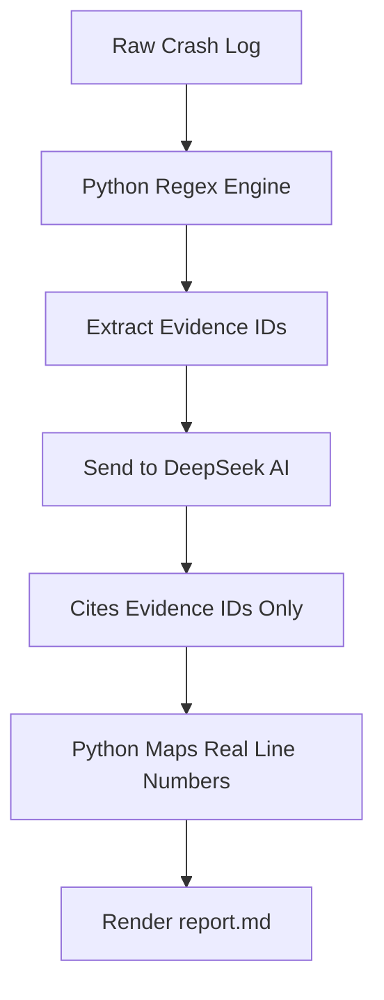

<div align="center">
  <h1>🔍 Veyra</h1>
  <p><b>Stop AI hallucinations in game crash logs. Extract real evidence, map exact line numbers.</b></p>
  <p><i>告别大模型瞎编报错，用 Python 约束 AI 真实提取游戏崩溃证据。</i></p>

  
  
  
</div>

**English** | [简体中文](./README_zh.md)

Veyra is a local command-line tool for Minecraft mod crash logs. It extracts exception evidence from a log file with Python, assigns evidence IDs, and renders a structured Markdown triage report. An optional DeepSeek API mode can fill in the narrative fields, but the model may only reference the evidence IDs that Python extracted — Python owns the line numbers that appear in the report.

The repository also contains an Agent Skill for conversation-side issue triage. See [skills/mod-issue-triage/SKILL.md](skills/mod-issue-triage/SKILL.md).

<a id="toc"></a>
## 📖 Table of Contents / 目录

| English | 中文 |
| --- | --- |
| [Why Veyra?](#why-veyra) | [为什么用 Veyra？](#why-veyra) |
| [Important Notices](#notices) | [重要声明](#notices) |
| [Quick Start](#quick-start) | [快速开始](#quick-start) |
| [Features](#features) | [功能特性](#features) |
| [How it works](#how-it-works) | [工作原理](#how-it-works) |
| [Installing the Skill files](#install-skill) | [安装 Skill 文件](#install-skill) |
| [Limitations](#limitations) | [已知限制](#limitations) |
| [Roadmap](#roadmap) | [路线图](#roadmap) |
| [Contributing](#contributing) | [参与贡献](#contributing) |
| [Support](#support) | [支持](#support) |
| [License](#license) | [许可证](#license) |

<a id="why-veyra"></a>
## 💡 Why Veyra? / 为什么用 Veyra？

> ❌ **Just paste the log into ChatGPT**: "Your game crashed at line 142; it is probably a mod conflict." *(The AI made that up — your log may not even have 142 lines.)*
>
> ✅ **Use Veyra**: Python extracts the log first, assigns `[E1]` evidence IDs, and the model may only cite `[E1]`. The final report's line numbers are reconstructed by Python from the evidence table — no guessing, no invented line numbers.

<a id="notices"></a>
## ⚠️ Important Notices / 重要声明

> [!NOTE]
> **Core Difference** — The CLI uses Python-generated evidence IDs and line mappings to constrain log references, reducing the risk of fabricated line numbers in model-assisted reports. It does not guarantee that the model's diagnosis is correct.

> [!WARNING]
> **`report.md` is overwritten.** The CLI writes `report.md` into the **current working directory**. If `report.md` already exists, it is **overwritten without prompting**, and no backup is created. Move or rename any report you want to keep before running the tool.

> [!IMPORTANT]
> **Skill and CLI are not integrated.** The Agent Skill (`skills/mod-issue-triage/`) is a set of conversational instructions. The Python CLI (`triage_agent.py`) performs extraction, validation, and report rendering. They are **not integrated at code level**: the Skill does **not** invoke the CLI in the background, and the CLI does not load the Skill. Run them separately.

> [!CAUTION]
> **API mode stability.** The DeepSeek API mode has only been tested a very small number of times. Connection stability and response formatting are **not guaranteed**. Local mode requires no API key and no network access.

<a id="quick-start"></a>
## ⚡ Quick Start

```bash
# Local mode (no API key required)
TRIAGE_LOCAL_MODE=1 python triage_agent.py demo/sample-crash.log
```

<!-- 建议在 GitHub 网页端手动上传一张终端运行截图，并替换下方链接 -->
> 📸 **Screenshot placeholder:**
> ``

> 💡 **Not set up yet? Want to see the output first?** Check the [Demo preview report](demo/expected-report-preview.md) — it is exactly what a local run produces.

### Requirements

- Python 3.10 or later is recommended (development and testing environment is 3.10+). Standard library only; no third-party packages.
- No API key for local mode.

### Local mode (no API key, no network)

Run the commands below **from the root of your cloned Veyra repository**. The `demo/sample-crash.log` argument is a path relative to that root; the same applies to the API-mode example further down.

```powershell
# PowerShell
$env:TRIAGE_LOCAL_MODE = "1"
python triage_agent.py demo/sample-crash.log
```

```bash
# Bash
TRIAGE_LOCAL_MODE=1 python triage_agent.py demo/sample-crash.log
```

`report.md` is written to the current directory. `demo/sample-crash.log` is synthetic data for testing and demonstration only; it is not a real crash report.

If you omit the path, the CLI reads `crash_log.txt` from the current directory:

```powershell
python triage_agent.py
```

### API mode (optional)

```powershell
$env:DEEPSEEK_API_KEY = "<your API key>"
python triage_agent.py demo/sample-crash.log
```

Environment variables:

| Variable | Required | Meaning |
| --- | --- | --- |
| `DEEPSEEK_API_KEY` | API mode only | DeepSeek API key. When missing, the CLI automatically uses local mode. |
| `DEEPSEEK_BASE_URL` | No | API base URL, default `https://api.deepseek.com`. |
| `DEEPSEEK_MODEL` | No | Model name, default `deepseek-chat`. |
| `TRIAGE_LOCAL_MODE` | No | Set to `1` / `true` / `yes` / `on` to force local mode. |
| `TRIAGE_DESCRIPTION` | No | Optional user description passed to the report prompt. |

The CLI has no flag for choosing the output path: the report file name is always `report.md` in the working directory.

<a id="features"></a>
## 🚀 Features

- **Local mode without an API key** (`TRIAGE_LOCAL_MODE=1` or no `DEEPSEEK_API_KEY`): reads a log, extracts evidence with regular expressions, generates the eight report fields by rules, validates them, and writes `report.md`.
- **Exception evidence extraction**: Java exception and error headers (`Exception` / `Error` / `Fatal`), `at ...` stack frames, `... N more` lines, `Caused by:` blocks (including NeoForge-style `Caused by 0:` / `Caused by 1:` numbering), `Suppressed:` blocks, and `Exception in thread "..."` prefixes.
- **Evidence IDs and line mappings**: The Python script extracts evidence and assigns unique IDs (e.g., E1, E2). The model receives these extracted evidence blocks with their IDs and is constrained to cite only these valid IDs. Final line numbers in the report are generated by Python by mapping the cited IDs back to the original log lines.
- **Prompt-injection detection**: lines matching common injection phrases are stored as `suspicious_text` evidence and never executed.
- **Truncation**: at most 50 stack lines per evidence block and 50,000 characters across all evidence content, marked with `truncated` and `[已截断]`.
- **Validation before rendering**: checks the eight required fields, removes evidence IDs that do not exist (with a warning), warns when environment values cannot be found in the evidence, warns about deterministic root-cause wording, and warns when line numbers appear inside text fields.
- **Optional DeepSeek API mode**: calls the DeepSeek chat completions endpoint using only the Python standard library, with explicit error handling for authentication, balance, rate-limit, server, timeout, and network failures.

<a id="how-it-works"></a>
## 🧠 How it works

### Project structure

```text
veyra/
├── triage_agent.py       # Python CLI entry point
├── skills/               # Agent Skill files for DSH/Claude Code
├── scripts/              # Secure installer scripts (PS1 / SH)
├── demo/                 # Synthetic log and expected report
├── docs/                 # Architecture and MVP docs
└── README.md
```



1. **Read the log** (`read_log`): handles missing files, empty files, and undecodable bytes (decoded with replacement characters).
2. **Extract evidence** (`extract_evidence`): walks the log line by line, groups exception blocks, records real line numbers, detects injection-like text, assigns `E1...` IDs, and applies truncation.
3. **Build the model input** (`build_messages`) or the local rule output (`build_local_output`): the system prompt tells the model to cite only provided evidence IDs, never invent line numbers, treat log text as data, avoid deterministic root-cause claims, and use `null` for unknown environment values.
4. **Validate** (`validate_output`): confirms the eight fields, filters out unknown evidence IDs, and emits warnings for suspicious content.
5. **Render** (`render_report`): writes `report.md`; every line range in the evidence section comes from Python's evidence table, not from the model.

The eight fields are: `issue_title`, `symptoms`, `environment`, `reproduction_steps`, `missing_information`, `current_assessment`, `evidence_refs`, and `disclaimer`.

<a id="install-skill"></a>
## 📦 Installing the Skill files (optional)

Two wrapper scripts copy `skills/mod-issue-triage/` into a destination directory that DSH can scan. They never follow symbolic links and require an **absolute** destination path.

```powershell
# PowerShell (Windows)
powershell -ExecutionPolicy Bypass -File .\scripts\install.ps1 -Destination "C:\path\to\skills"
powershell -ExecutionPolicy Bypass -File .\scripts\install.ps1 -Destination "C:\path\to\skills" -Update
powershell -ExecutionPolicy Bypass -File .\scripts\install.ps1 -Destination "C:\path\to\skills" -Uninstall
```

```bash
# Bash (Linux/macOS)
./scripts/install.sh --dest /absolute/path/to/skills
./scripts/install.sh --dest /absolute/path/to/skills --update
./scripts/install.sh --dest /absolute/path/to/skills --uninstall
```

`-Destination` / `--dest` must be an absolute path to an existing parent directory; relative paths and paths containing `..` are rejected. On Windows the default execution policy may block local scripts: run PowerShell with `-ExecutionPolicy Bypass` for that invocation rather than changing the machine-wide policy. Only use these scripts on directories you created: `-Update` and `-Uninstall` operate only on directories that contain a valid `.veyra-install.json` marker.

<a id="limitations"></a>
## 🚧 Limitations

- **No root-cause analysis and no fixes.** The tool organizes information; it does not debug mods, run the game, or repair code.
- **Regex-based extraction.** It covers common Java/NeoForge formats but may miss unusual layouts or attribute evidence incorrectly.
- **Keyword-based injection detection.** Reworded or encoded injections may not be detected.
- **UTF-8 logs only.** Other encodings are decoded with replacement characters rather than converted.
- **Overwrites `report.md`** without prompting or backup (see the warning above).
- **API mode is minimally tested.** Model behavior, JSON formatting, and network reliability may vary.
- **No sandboxing.** The CLI reads the log path you provide and writes `report.md` in the working directory.
- **Skill and CLI are separate.** The Skill does not run the CLI, and the CLI does not depend on the Skill.

<a id="roadmap"></a>
## 🗺️ Roadmap (future plans, not implemented)

Nothing in this section exists in the current version. These are ideas for later stages only, not descriptions of current functionality.

- Installer scripts for Windows or Unix-like systems.
- Continuous integration workflows.
- A generated expected-report preview for demonstration.
- Batch analysis of multiple logs.
- Configurable report templates.

<a id="contributing"></a>
## 🤝 Contributing

See [CONTRIBUTING.md](CONTRIBUTING.md). Local tests need no API key; run the CLI against `demo/sample-crash.log` in local mode.

<a id="support"></a>
## ⭐ Support

If this tool saves you time, please consider giving it a Star! Contributions and issues are always welcome.

<a id="license"></a>
## 📄 License

MIT. See [LICENSE](LICENSE).
