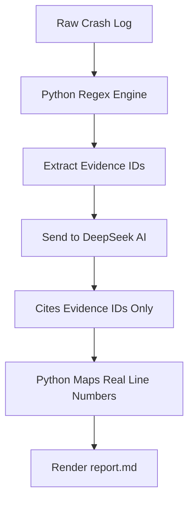

<div align="center">
  <h1>🔍 Veyra</h1>
  <p><b>Stop AI hallucinations in game crash logs. Extract real evidence, map exact line numbers.</b></p>
  <p><i>告别大模型瞎编报错，用 Python 约束 AI 真实提取游戏崩溃证据。</i></p>

  
  
  
  
</div>

[English](./README.md) | **简体中文**

Veyra 是一个通用的、本地运行的游戏 Mod 崩溃日志整理命令行工具。它用 Python 从日志中提取异常证据、分配证据 ID，并渲染结构化 Markdown 问题报告。证据提取与行号映射机制不依赖具体游戏引擎，当前正则库优先针对 Java/Minecraft 生态进行了深度优化。可选的 DeepSeek API 模式可以补全叙述字段，但模型只能引用 Python 提取出的证据 ID —— 报告中的行号由 Python 控制。机器可读的 JSON 模式（`--format json`，`schema_version` 1.0.0）输出同一份结构化分析结果，字段说明见 [docs/json-contract.md](docs/json-contract.md)。

仓库中还包含一个 Agent Skill，它把 JSON 输出转换为带证据引用的分析与维护者回复草稿，见 [skills/mod-issue-triage/SKILL.md](skills/mod-issue-triage/SKILL.md) 与 [Skill 工作流](#skill-workflow)。

<a id="toc"></a>
## 📖 Table of Contents / 目录

| English | 中文 |
| --- | --- |
| [Why Veyra?](#why-veyra) | [为什么用 Veyra？](#why-veyra) |
| [Important Notices](#notices) | [重要声明](#notices) |
| [Quick Start](#quick-start) | [快速开始](#quick-start) |
| [Features](#features) | [功能特性](#features) |
| [How it works](#how-it-works) | [工作原理](#how-it-works) |
| [Skill workflow](#skill-workflow) | [Skill 工作流](#skill-workflow) |
| [Installing the Skill files](#install-skill) | [安装 Skill 文件](#install-skill) |
| [Creation packs](#creation-packs) | [创作打包](#creation-packs) |
| [Limitations](#limitations) | [已知限制](#limitations) |
| [Roadmap](#roadmap) | [路线图](#roadmap) |
| [Contributing](#contributing) | [参与贡献](#contributing) |
| [Support](#support) | [支持](#support) |
| [License](#license) | [许可证](#license) |

<a id="why-veyra"></a>
## 💡 Why Veyra? / 为什么用 Veyra？

> ❌ **直接把日志扔给 ChatGPT**：“你的游戏在第 142 行崩溃了，可能是某个 Mod 冲突。” *（这是 AI 瞎编的——你的日志甚至可能根本没有 142 行。）*
>
> ✅ **使用 Veyra**：Python 先提取日志并分配 `[E1]` 证据 ID，模型只能引用 `[E1]`；最终报告里的行号由 Python 根据证据表真实映射生成。不乱猜，不瞎编。

<a id="notices"></a>
## ⚠️ Important Notices / 重要声明

> [!NOTE]
> **核心差异** —— CLI 使用由 Python 生成的证据 ID 与行号映射来约束日志引用，降低模型辅助报告中编造行号的风险；但它不保证模型的诊断结论正确。

> [!WARNING]
> **未指定输出路径时会替换 `report.md`。** 如果不传 `--output`，CLI 会在**当前工作目录**生成 `report.md`，并替换同名文件且不备份。写入本身是原子的（临时文件 + `os.replace`），缺失的父目录会自动创建；当输出路径与输入日志是同一个文件时，CLI 会**拒绝写入**。如需保留旧报告，请使用 `-o <路径>` / `--output <路径>`。

> [!IMPORTANT]
> **Skill 与 CLI 通过手动交接连接，而不是代码集成。** 先运行 CLI 并保存 JSON，再把该 JSON（粘贴为文本，或在你的客户端支持时作为附件提供）与玩家 Issue 文本一起交给 Skill。Skill 绝不会调用 CLI，CLI 也不会加载 Skill，并且不会自动向 GitHub 发送任何内容。

> [!NOTE]
> **Skill 消费 JSON 契约（`schema_version` 1.0.0）。** `--format json` 输出 [docs/json-contract.md](docs/json-contract.md) 中定义的契约（JSON Schema：[docs/report.schema.json](docs/report.schema.json)）。Skill 会先校验它，只引用其中**已经存在**的证据 ID，并生成供维护者自行修改、手动发送的回复草稿。

> [!CAUTION]
> **API 模式稳定性。** DeepSeek API 模式目前只经历过极少量测试，连接稳定性与返回格式**不作保证**。本地模式不需要 API Key，也不需要网络。

<a id="quick-start"></a>
## ⚡ Quick Start / 快速开始

```bash
# Local mode (no API key required)
TRIAGE_LOCAL_MODE=1 python triage_agent.py demo/sample-crash.log
```


> 💡 **还没配好环境？想先看效果？** 可以直接查看 [Demo 预览报告](demo/expected-report-preview.md)，这就是跑完一次会得到的结果。

### Requirements / 环境要求

- 推荐使用 Python 3.10 或更高版本（开发与测试环境为 Python 3.10+）。仅使用标准库，无需第三方包。
- 本地模式不需要 API Key。

### Local mode (no API key, no network) / 本地模式（不调用 API、不联网）

以下命令请**在克隆后的 Veyra 仓库根目录执行**。`demo/sample-crash.log` 是相对于仓库根目录的路径；下面的 API 模式示例同理。

```powershell
# PowerShell
$env:TRIAGE_LOCAL_MODE = "1"
python triage_agent.py demo/sample-crash.log
```

```bash
# Bash
TRIAGE_LOCAL_MODE=1 python triage_agent.py demo/sample-crash.log
```

报告会写入当前目录的 `report.md`。使用 `-o <路径>` / `--output <路径>` 可指定其他输出文件，避免覆盖已有报告。`demo/sample-crash.log` 是纯合成日志，仅用于测试与演示，不是真实崩溃日志。

不传路径时，CLI 会读取当前目录下的 `crash_log.txt`：

```powershell
python triage_agent.py
```

### JSON 输出（机器可读）

使用 `--format json` 可将同一份分析结果输出为结构化对象。不传 `-o` 时，JSON 写入 **stdout**，不会在磁盘上生成文件；进度与错误信息写入 **stderr**，因此 stdout 始终是可解析的完整 JSON。

```powershell
# 输出到 stdout
$env:TRIAGE_LOCAL_MODE = "1"
python triage_agent.py demo/sample-crash.log --format json

# 写入文件（原子替换，安全规则与 report.md 相同）
python triage_agent.py demo/sample-crash.log --format json -o result.json
```

```bash
TRIAGE_LOCAL_MODE=1 python triage_agent.py demo/sample-crash.log --format json | python -m json.tool
```

`-o` 在两种格式下含义相同：写入指定路径的文件。只有“JSON 模式 + 不传 `-o`”才会打印到 stdout。字段级契约见 [docs/json-contract.md](docs/json-contract.md)。

### API mode (optional) / API 模式（可选）

任何 OpenAI 兼容接口都可以使用；`LLM_*` 变量优先于 `DEEPSEEK_*`。

```powershell
# DeepSeek（默认地址）
$env:DEEPSEEK_API_KEY = "<你的 API Key>"
python triage_agent.py demo/sample-crash.log

# Kimi / Moonshot（OpenAI 兼容）
$env:LLM_API_KEY = "<你的 Key>"
$env:LLM_BASE_URL = "https://api.moonshot.cn/v1"
$env:LLM_MODEL = "moonshot-v1-8k"
python triage_agent.py demo/sample-crash.log -o report-kimi.md

# 本地 Ollama（OpenAI 兼容；CLI 只要求 Key 非空）
$env:LLM_API_KEY = "ollama"
$env:LLM_BASE_URL = "http://localhost:11434/v1"
$env:LLM_MODEL = "llama3.1"
python triage_agent.py demo/sample-crash.log -o report-ollama.md
```

环境变量：

| 变量 | 是否必填 | 含义 |
| --- | --- | --- |
| `LLM_API_KEY` | API 模式（优先） | 任意 OpenAI 兼容服务的 API Key；设置后覆盖 `DEEPSEEK_API_KEY`。 |
| `LLM_BASE_URL` | 否 | 兼容服务的 Base URL；设置后覆盖 `DEEPSEEK_BASE_URL`。 |
| `LLM_MODEL` | 否 | 模型名称；设置后覆盖 `DEEPSEEK_MODEL`。 |
| `DEEPSEEK_API_KEY` | API 模式（回退） | DeepSeek Key；仅在未设置 `LLM_API_KEY` 时使用。 |
| `DEEPSEEK_BASE_URL` | 否 | DeepSeek 地址（默认 `https://api.deepseek.com`），仅在未设置 `LLM_BASE_URL` 时使用。 |
| `DEEPSEEK_MODEL` | 否 | DeepSeek 模型名（默认 `deepseek-chat`），仅在未设置 `LLM_MODEL` 时使用。 |
| `TRIAGE_LOCAL_MODE` | 否 | 设为 `1` / `true` / `yes` / `on` 时强制本地模式。 |
| `TRIAGE_DESCRIPTION` | 否 | 可选，用户问题描述，会传入报告提示词。 |

配置 `LLM_*` 会覆盖对应的 `DEEPSEEK_*`，因此无需改代码即可接入 Kimi、Ollama 及其他 OpenAI 兼容服务。

报告路径可通过 `-o <路径>` 或 `--output <路径>` 指定（例如 `python triage_agent.py demo/sample-crash.log -o my-report.md`）；不指定时仍为工作目录下的 `report.md`。`python triage_agent.py --help` 显示中文用法，`python triage_agent.py --version` 打印版本号。

<a id="features"></a>
## 🚀 Features / 功能特性

- **无需 API Key 的本地模式**（`TRIAGE_LOCAL_MODE=1`，或未配置 `LLM_API_KEY` / `DEEPSEEK_API_KEY`）：读取日志、用正则提取证据、从日志文本中提取运行环境、按规则生成 8 个字段、执行校验并写出 `report.md`。
- **环境信息抽取**（`extract_environment`）：只读取日志中明确写出的内容——`Minecraft Version:`、`Java Version:`、`Operating System:`、`Loading Minecraft <版本> with <加载器> <版本>`、`Found mod file <名称>-<版本>.jar`，以及崩溃报告中的 `Mod List` 表格。缺失字段保持 `null`；同一字段出现多个不同值时，该字段留空并把这些候选值写进“还需要的信息”，而不是替用户猜一个。**本地模式与 API 模式都执行同一套 Python 抽取**，同一份日志不会因为是否调用模型而得到不同的环境事实。
- **机器可读 JSON 契约**（`--format json`，`schema_version` 1.0.0）：从与 Markdown 相同的已校验分析对象输出 `tool`、`mode`、`summary`、`environment`、`model_environment`、`mods`、`evidence`、`missing_information`、`conflicts`、`warnings`。Python 的环境事实始终为准；API 模式下模型自己报告的环境值单独保存在 `model_environment`，绝不覆盖前者。
- **安全写入报告**（`write_report_text`）：自动创建缺失的父目录，先写同目录临时文件再用 `os.replace` 替换目标文件，因此写入失败不会留下半截报告；输出路径指向输入日志时直接拒绝写入（退出码 2）。
- **异常证据提取**：支持 Java 异常/错误标题行（`Exception` / `Error` / `Fatal`）、`at ...` 堆栈行、`... N more`、`Caused by:` 块（含 NeoForge 风格的 `Caused by 0:` / `Caused by 1:` 编号）、`Suppressed:` 块，以及 `Exception in thread "..."` 前缀。
- **证据 ID 与行号映射**：Python 脚本提取证据并分配唯一 ID（如 E1、E2）。模型接收带有 ID 的提取证据，并被要求只引用这些有效 ID；最终报告中的行号由 Python 根据证据 ID 映射生成。
- **提示词注入检测**：命中常见注入短语的行会被记录为 `suspicious_text` 证据，绝不会被执行。
- **截断**：单个证据块最多保留 50 行堆栈，全部证据内容最多 50000 字符，截断时标记 `truncated` 与 `[已截断]`。
- **渲染前校验**：检查 8 个必需字段；剔除不存在的证据 ID 并警告；对无法在证据中找到依据的环境值、确定性根因表述、文本字段中的行号引用分别给出警告。
- **可选的 OpenAI 兼容 API 模式**：仅使用 Python 标准库调用任何 OpenAI 兼容的 chat completions 接口（DeepSeek、Kimi/Moonshot、本地 Ollama 等），并针对认证失败、余额不足、限流、服务端错误、超时与网络错误给出明确处理。
- **基于证据的 Skill 分析**：`skills/mod-issue-triage/` 接收 JSON 契约与玩家 Issue 文本，输出 7 段分析：日志事实只引用已存在的证据 ID，玩家陈述与 AI 推测分别标注，冲突的环境值保持可见。分析前可用标准库校验器（`skills/mod-issue-triage/scripts/validate_issue_json.py`）检查 JSON。
- **维护者回复草稿**：Skill 针对三种场景（初次回复、调查进展、解决方案）生成回复草稿，语言跟随玩家，供维护者修改后手动发送，不会自动发布。

<a id="how-it-works"></a>
## 🧠 How it works / 工作原理

### Project structure / 项目结构

```text
veyra/
├── triage_agent.py       # Python CLI entry point
├── skills/mod-issue-triage/  # Agent Skill: JSON → analysis → reply draft
│   ├── SKILL.md
│   ├── references/report-template.md
│   ├── scripts/validate_issue_json.py
│   └── evals/            # 10 synthetic cases + review criteria
├── scripts/              # Secure installer scripts (PS1 / SH)
├── tests/                # unittest regression tests
├── demo/                 # Synthetic log and expected report
├── docs/                 # JSON contract, schema, and MVP status
└── README.md
```



1. **读取日志**（`read_log`）：处理文件不存在、文件为空、无法解码的字节（用替换字符解码）。
2. **提取证据**（`extract_evidence`）：逐行扫描日志，聚合异常块，记录真实行号，检测疑似注入文本，分配 `E1...` ID，并应用截断。
3. **组装模型输入**（`build_messages`）或**本地规则输出**（`build_local_output`）：系统提示词要求模型只引用给定证据 ID、不编造行号、把日志文本当数据、不给出确定性根因、未知环境值一律用 `null`。
4. **校验**（`validate_output`）：确认 8 个字段，过滤未知证据 ID，并对可疑内容给出警告。
5. **渲染**（`render_report`）：原子地写出报告；证据小节中的每一处行号都来自 Python 的证据表，而不是模型。
6. **序列化**（`build_report_contract` / `serialize_contract`）：Markdown 与 JSON 来自同一个已校验的分析对象。证据条目原样复制——ID、类型、内容和真实行号绝不重新生成或重新编号。

8 个字段为：`issue_title`、`symptoms`、`environment`、`reproduction_steps`、`missing_information`、`current_assessment`、`evidence_refs`、`disclaimer`。

<a id="skill-workflow"></a>
## 🤖 Skill 工作流：JSON → 维护者回复草稿

Skill（`skills/mod-issue-triage/`）是一组提示词层面的工作流，不是一个服务。它可以在任何能加载该 Skill、并能接收文本的聊天客户端中工作。从 CLI 到 Skill 的交接刻意保持手动：

1. **分析日志并保存 JSON。**
   ```bash
   TRIAGE_LOCAL_MODE=1 python triage_agent.py crash.log --format json -o issue.json
   ```
2. **给 Skill 两类输入：** JSON（粘贴为文本；若客户端支持附件，也可以附上文件）与玩家 Issue——标题、描述、复现步骤、预期/实际行为，以及已经尝试过的方法。玩家描述是可选的；如果缺失，Skill 必须说明这是“仅基于日志”的分析，不能编造上下文。
3. **让它先校验。** 当 `schema_version` 不受支持（不是已知的 `1.x`）、缺少必需字段或证据结构损坏时，Skill 会停止，而不会静默修复契约或猜测。
4. **阅读 7 个部分：** Issue Overview、Environment、Evidence Analysis、Possible Causes、Missing Information、Recommended Actions、Maintainer Reply Draft。每条日志事实都带有 JSON 中已有的证据 ID 与真实行号；玩家声称的内容保持“玩家陈述”标签；Skill 自己的假设标记为推测。
5. **自行修改并发送回复。** 草稿用于复制到 Issue 讨论串；回复语言跟随玩家（无法判断时用英文）。不会自动发布。

可以先用与 Skill 相同的规则预检 JSON：

```bash
python skills/mod-issue-triage/scripts/validate_issue_json.py issue.json
```

回复草稿覆盖三种情况：**A. 初次回复**（还不足以调查，只索取能缩小范围的信息）、**B. 调查进展**（发现了相关证据，但原因尚未确认）、**C. 解决方案**（证据支持明确操作）。如果证据只支持 B，Skill 不得写成 C。

<a id="install-skill"></a>
## 📦 Installing the Skill files (optional) / 安装 Skill 文件（可选）

两个包装脚本会把 `skills/mod-issue-triage/` 复制到 DSH 可扫描的目标目录。脚本不会跟随符号链接，并且要求 Destination 为**绝对路径**。

```powershell
# PowerShell（Windows）
powershell -ExecutionPolicy Bypass -File .\scripts\install.ps1 -Destination "C:\path\to\skills"
powershell -ExecutionPolicy Bypass -File .\scripts\install.ps1 -Destination "C:\path\to\skills" -Update
powershell -ExecutionPolicy Bypass -File .\scripts\install.ps1 -Destination "C:\path\to\skills" -Uninstall
```

```bash
# Bash（Linux/macOS）
./scripts/install.sh --dest /absolute/path/to/skills
./scripts/install.sh --dest /absolute/path/to/skills --update
./scripts/install.sh --dest /absolute/path/to/skills --uninstall
```

`-Destination` / `--dest` 必须是已存在父目录的绝对路径；相对路径和包含 `..` 的路径会被拒绝。Windows 默认的 PowerShell 执行策略可能阻止运行本地脚本：对本次调用使用 `-ExecutionPolicy Bypass` 即可，不要修改系统级策略。请只对你自己创建的目录运行这些脚本：`-Update` 与 `-Uninstall` 只操作包含合法 `.veyra-install.json` 标记的目录。

<a id="creation-packs"></a>
## 🧰 Creation packs（离线，实验性）

Phase 3.1 新增了一个独立的离线打包工具，用于把创作成果（角色套件、主题、Mod 工程等）整理成可分发的包。它只使用 Python 标准库，不调用模型、不联网：

```bash
python -m veyra_pack init my-kit --name "My Kit" --type character_kit
python -m veyra_pack validate my-kit
python -m veyra_pack export my-kit -o my-kit.zip
```

清单字段、硬性上限、路径安全规则与确定性 ZIP 导出在 [docs/pack-contract.md](docs/pack-contract.md) 中定义。该契约与崩溃诊断的 JSON 契约相互独立，`triage_agent.py` 未做修改。

<a id="limitations"></a>
## 🚧 Limitations / 已知限制

- **不做根因分析，也不修复问题。** 工具负责整理信息，不调试 Mod、不启动游戏、不修改代码。
- **基于正则的提取。** 覆盖常见 Java/NeoForge 格式，但可能遗漏特殊排版或归属错误的证据。
- **当前以 Java 日志为主。** 当前的正则引擎针对 Java 系游戏（如 Minecraft）进行了深度优化；其他引擎（如 Unity、Unreal）的日志格式可能需要额外适配。
- **基于关键词的注入检测。** 改写或编码后的注入文本可能检测不到。
- **仅支持 UTF-8 日志。** 其他编码会以替换字符解码，而不是转换。
- **会替换 `report.md`**，无提示、无备份（见上方警告）。替换是原子的，不会与旧文件混合，但如果不传 `-o`，上一份报告仍然会丢失。
- **API 模式测试极少。** 模型行为、JSON 格式与网络可靠性都可能变化。
- **JSON 契约为 v1.0.0。** 顶层结构与证据字段在本版本内固定；新增可选字段需要升级 `schema_version` 并同步契约文档。消费方应依据 `schema_version` 判断兼容性，而不是工具版本号。
- **打包工具刚实现，验证有限。** `veyra_pack` 目前只在测试中用合成包验证过，尚未用真实游戏素材或真实游戏的导入流程检验。
- **没有沙箱隔离。** CLI 会读取你指定的日志路径，并在工作目录写出 `report.md`。
- **Skill 与 CLI 相互独立。** Skill 不会运行 CLI，需要用户自行提供 JSON；CLI 不依赖 Skill。Skill 的分析质量由人工审查，**没有**自动化输出测试覆盖。
- **Skill 输出只是草稿，不会执行动作。** 回复草稿不会发布到任何地方，由维护者修改后发送；不会创建或关闭 Issue。

<a id="roadmap"></a>
## 🗺️ Roadmap (future plans, not implemented) / 路线图（未来计划，尚未实现）

本节内容在当前版本中**均不存在**，仅作为后续阶段的想法，不是对现有功能的描述。此前阶段已交付：安全安装脚本（`scripts/`）、CI 工作流（`.github/workflows/test.yml`）、演示预览报告（`demo/expected-report-preview.md`）。

- 多日志批量分析。
- 可配置的报告模板。
- 支持更多游戏引擎（Unity、Unreal、Godot）及其崩溃日志格式。

<a id="contributing"></a>
## 🤝 Contributing / 参与贡献

见 [CONTRIBUTING.md](CONTRIBUTING.md)。本地测试无需 API Key：

```bash
python triage_agent.py demo/sample-crash.log -o /tmp/veyra-check.md
python triage_agent.py demo/sample-crash.log --format json -o /tmp/veyra-check.json
python skills/mod-issue-triage/scripts/validate_issue_json.py /tmp/veyra-check.json
python -m unittest discover -s tests
```

<a id="support"></a>
## ⭐ Support / 支持

如果这个工具为你节省了时间，欢迎给项目点一个 Star！也欢迎提交 Issue 与 Pull Request。

<a id="license"></a>
## 📄 License / 许可证

MIT，见 [LICENSE](LICENSE)。
