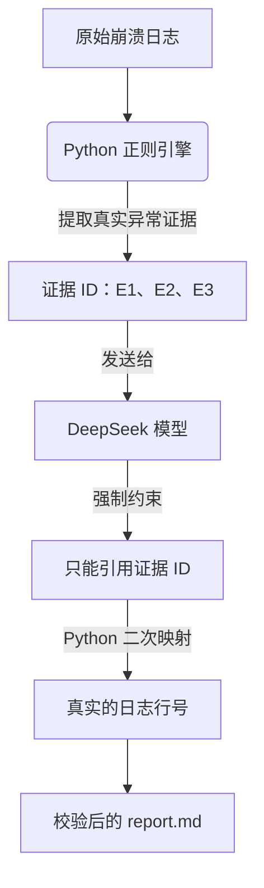

<div align="center">
  <h1>🔍 Veyra</h1>
  <p><b>Stop AI hallucinations in game crash logs. Extract real evidence, map exact line numbers.</b></p>
  <p><i>告别大模型瞎编报错，用 Python 约束 AI 真实提取游戏崩溃证据。</i></p>

  
  
  
  
</div>

Veyra 是一个面向 Minecraft Mod 崩溃日志的本地命令行工具。它用 Python 从日志中提取异常证据、分配证据 ID，并渲染结构化 Markdown 问题报告。可选的 DeepSeek API 模式可以补全叙述字段，但模型只能引用 Python 提取出的证据 ID —— 报告中的行号由 Python 控制。

仓库中还包含一个用于对话侧问题整理的 Agent Skill，见 [skills/mod-issue-triage/SKILL.md](skills/mod-issue-triage/SKILL.md)。

<a id="toc"></a>
## 📖 Table of Contents / 目录

| English | 中文 |
| --- | --- |
| [Why Veyra?](#why-veyra) | [为什么用 Veyra？](#why-veyra) |
| [Important Notices](#notices) | [重要声明](#notices) |
| [Features](#features) | [功能特性](#features) |
| [Quick Start](#quick-start) | [快速开始](#quick-start) |
| [Installing the Skill files](#install-skill) | [安装 Skill 文件](#install-skill) |
| [How it works](#how-it-works) | [工作原理](#how-it-works) |
| [Limitations](#limitations) | [已知限制](#limitations) |
| [Roadmap](#roadmap) | [路线图](#roadmap) |
| [Contributing](#contributing) | [参与贡献](#contributing) |
| [Support](#support) | [支持](#support) |
| [License](#license) | [许可证](#license) |

<a id="why-veyra"></a>
## 💡 Why Veyra? / 为什么用 Veyra？

> ❌ **直接把日志扔给 ChatGPT**：“你的游戏在第 142 行崩溃了，可能是某个 Mod 冲突。” *（这是 AI 瞎编的——你的日志甚至可能根本没有 142 行。）*
>
> ✅ **使用 Veyra**：Python 先提取日志并分配 `[E1]` 证据 ID，模型只能引用 `[E1]`；最终报告里的行号由 Python 根据证据表真实映射生成。不乱猜，不瞎编。

<a id="notices"></a>
## ⚠️ Important Notices / 重要声明

> [!NOTE]
> **核心差异** —— CLI 使用由 Python 生成的证据 ID 与行号映射来约束日志引用，降低模型辅助报告中编造行号的风险；但它不保证模型的诊断结论正确。

> [!WARNING]
> **`report.md` 会被覆盖。** CLI 会在**当前工作目录**生成 `report.md`。如果同名文件已存在，会被**无提示覆盖**，并且**不会自动备份**。运行前请先移动或重命名需要保留的报告。

> [!IMPORTANT]
> **Skill 与 CLI 没有集成。** Agent Skill（`skills/mod-issue-triage/`）是一组对话规范；Python CLI（`triage_agent.py`）负责提取、校验和渲染报告。两者**没有代码级的自动集成**：Skill **不会**在后台调用 CLI，CLI 也不会加载 Skill。它们需要分别使用。

> [!CAUTION]
> **API 模式稳定性。** DeepSeek API 模式目前只经历过极少量测试，连接稳定性与返回格式**不作保证**。本地模式不需要 API Key，也不需要网络。

<a id="features"></a>
## 🚀 Features / 功能特性

- **无需 API Key 的本地模式**（`TRIAGE_LOCAL_MODE=1` 或未配置 `DEEPSEEK_API_KEY`）：读取日志、用正则提取证据、按规则生成 8 个字段、执行校验并写出 `report.md`。
- **异常证据提取**：支持 Java 异常/错误标题行（`Exception` / `Error` / `Fatal`）、`at ...` 堆栈行、`... N more`、`Caused by:` 块（含 NeoForge 风格的 `Caused by 0:` / `Caused by 1:` 编号）、`Suppressed:` 块，以及 `Exception in thread "..."` 前缀。
- **证据 ID 与行号映射**：Python 脚本提取证据并分配唯一 ID（如 E1、E2）。模型接收带有 ID 的提取证据，并被要求只引用这些有效 ID；最终报告中的行号由 Python 根据证据 ID 映射生成。
- **提示词注入检测**：命中常见注入短语的行会被记录为 `suspicious_text` 证据，绝不会被执行。
- **截断**：单个证据块最多保留 50 行堆栈，全部证据内容最多 50000 字符，截断时标记 `truncated` 与 `[已截断]`。
- **渲染前校验**：检查 8 个必需字段；剔除不存在的证据 ID 并警告；对无法在证据中找到依据的环境值、确定性根因表述、文本字段中的行号引用分别给出警告。
- **可选的 DeepSeek API 模式**：仅使用 Python 标准库调用 DeepSeek chat completions 接口，并针对认证失败、余额不足、限流、服务端错误、超时与网络错误给出明确处理。

<a id="quick-start"></a>
## ⚡ Quick Start / 快速开始

> 💡 **还没配好环境？想先看效果？** 可以直接查看 [Demo 预览报告](demo/expected-report-preview.md)，这就是跑完一次会得到的结果。

### Requirements / 环境要求

- 推荐使用 Python 3.10 或更高版本（开发与测试环境为 Python 3.10+）。仅使用标准库，无需第三方包。
- 本地模式不需要 API Key。

### Local mode (no API key, no network) / 本地模式（不调用 API、不联网）

以下命令请**在克隆后的 Veyra 仓库根目录执行**。`demo/sample-crash.log` 是相对于仓库根目录的路径；下面的 API 模式示例同理。

```powershell
# PowerShell
$env:TRIAGE_LOCAL_MODE = "1"
python triage_agent.py demo/sample-crash.log
```

```bash
# Bash
TRIAGE_LOCAL_MODE=1 python triage_agent.py demo/sample-crash.log
```

报告会写入当前目录的 `report.md`。`demo/sample-crash.log` 是纯合成日志，仅用于测试与演示，不是真实崩溃日志。

不传路径时，CLI 会读取当前目录下的 `crash_log.txt`：

```powershell
python triage_agent.py
```

### API mode (optional) / API 模式（可选）

```powershell
$env:DEEPSEEK_API_KEY = "<你的 API Key>"
python triage_agent.py demo/sample-crash.log
```

环境变量：

| 变量 | 是否必填 | 含义 |
| --- | --- | --- |
| `DEEPSEEK_API_KEY` | 仅 API 模式必填 | DeepSeek API Key；未配置时自动进入本地模式。 |
| `DEEPSEEK_BASE_URL` | 否 | API 地址，默认 `https://api.deepseek.com`。 |
| `DEEPSEEK_MODEL` | 否 | 模型名称，默认 `deepseek-chat`。 |
| `TRIAGE_LOCAL_MODE` | 否 | 设为 `1` / `true` / `yes` / `on` 时强制本地模式。 |
| `TRIAGE_DESCRIPTION` | 否 | 可选，用户问题描述，会传入报告提示词。 |

CLI 没有选择输出路径的参数：报告文件名固定为工作目录下的 `report.md`。

<a id="install-skill"></a>
## 📦 Installing the Skill files (optional) / 安装 Skill 文件（可选）

两个包装脚本会把 `skills/mod-issue-triage/` 复制到 DSH 可扫描的目标目录。脚本不会跟随符号链接，并且要求 Destination 为**绝对路径**。

```powershell
# PowerShell（Windows）
powershell -ExecutionPolicy Bypass -File .\scripts\install.ps1 -Destination "C:\path\to\skills"
powershell -ExecutionPolicy Bypass -File .\scripts\install.ps1 -Destination "C:\path\to\skills" -Update
powershell -ExecutionPolicy Bypass -File .\scripts\install.ps1 -Destination "C:\path\to\skills" -Uninstall
```

```bash
# Bash（Linux/macOS）
./scripts/install.sh --dest /absolute/path/to/skills
./scripts/install.sh --dest /absolute/path/to/skills --update
./scripts/install.sh --dest /absolute/path/to/skills --uninstall
```

`-Destination` / `--dest` 必须是已存在父目录的绝对路径；相对路径和包含 `..` 的路径会被拒绝。Windows 默认的 PowerShell 执行策略可能阻止运行本地脚本：对本次调用使用 `-ExecutionPolicy Bypass` 即可，不要修改系统级策略。请只对你自己创建的目录运行这些脚本：`-Update` 与 `-Uninstall` 只操作包含合法 `.veyra-install.json` 标记的目录。

<a id="how-it-works"></a>
## 🧠 How it works / 工作原理



1. **读取日志**（`read_log`）：处理文件不存在、文件为空、无法解码的字节（用替换字符解码）。
2. **提取证据**（`extract_evidence`）：逐行扫描日志，聚合异常块，记录真实行号，检测疑似注入文本，分配 `E1...` ID，并应用截断。
3. **组装模型输入**（`build_messages`）或**本地规则输出**（`build_local_output`）：系统提示词要求模型只引用给定证据 ID、不编造行号、把日志文本当数据、不给出确定性根因、未知环境值一律用 `null`。
4. **校验**（`validate_output`）：确认 8 个字段，过滤未知证据 ID，并对可疑内容给出警告。
5. **渲染**（`render_report`）：写出 `report.md`；证据小节中的每一处行号都来自 Python 的证据表，而不是模型。

8 个字段为：`issue_title`、`symptoms`、`environment`、`reproduction_steps`、`missing_information`、`current_assessment`、`evidence_refs`、`disclaimer`。

<a id="limitations"></a>
## 🚧 Limitations / 已知限制

- **不做根因分析，也不修复问题。** 工具负责整理信息，不调试 Mod、不启动游戏、不修改代码。
- **基于正则的提取。** 覆盖常见 Java/NeoForge 格式，但可能遗漏特殊排版或归属错误的证据。
- **基于关键词的注入检测。** 改写或编码后的注入文本可能检测不到。
- **仅支持 UTF-8 日志。** 其他编码会以替换字符解码，而不是转换。
- **会覆盖 `report.md`**，无提示、无备份（见上方警告）。
- **API 模式测试极少。** 模型行为、JSON 格式与网络可靠性都可能变化。
- **没有沙箱隔离。** CLI 会读取你指定的日志路径，并在工作目录写出 `report.md`。
- **Skill 与 CLI 相互独立。** Skill 不会运行 CLI，CLI 也不依赖 Skill。

<a id="roadmap"></a>
## 🗺️ Roadmap (future plans, not implemented) / 路线图（未来计划，尚未实现）

本节内容在当前版本中**均不存在**，仅作为后续阶段的想法，不是对现有功能的描述。

- Windows 或类 Unix 系统的安装脚本。
- 持续集成（CI）工作流。
- 用于演示的预期报告预览文件。
- 多日志批量分析。
- 可配置的报告模板。

<a id="contributing"></a>
## 🤝 Contributing / 参与贡献

见 [CONTRIBUTING.md](CONTRIBUTING.md)。本地测试无需 API Key：在本地模式下对 `demo/sample-crash.log` 运行 CLI 即可。

<a id="support"></a>
## ⭐ Support / 支持

如果这个工具为你节省了时间，欢迎给项目点一个 Star！也欢迎提交 Issue 与 Pull Request。

<a id="license"></a>
## 📄 License / 许可证

MIT，见 [LICENSE](LICENSE)。
